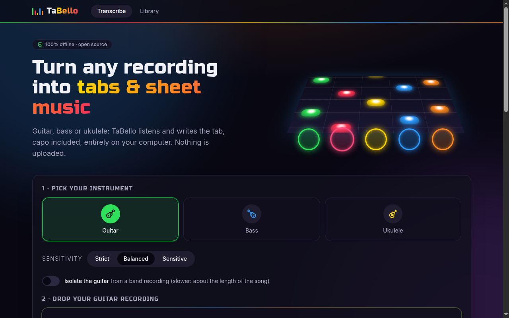
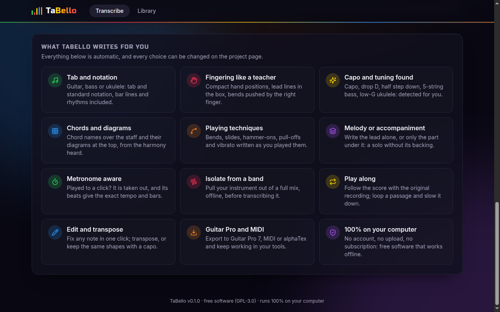
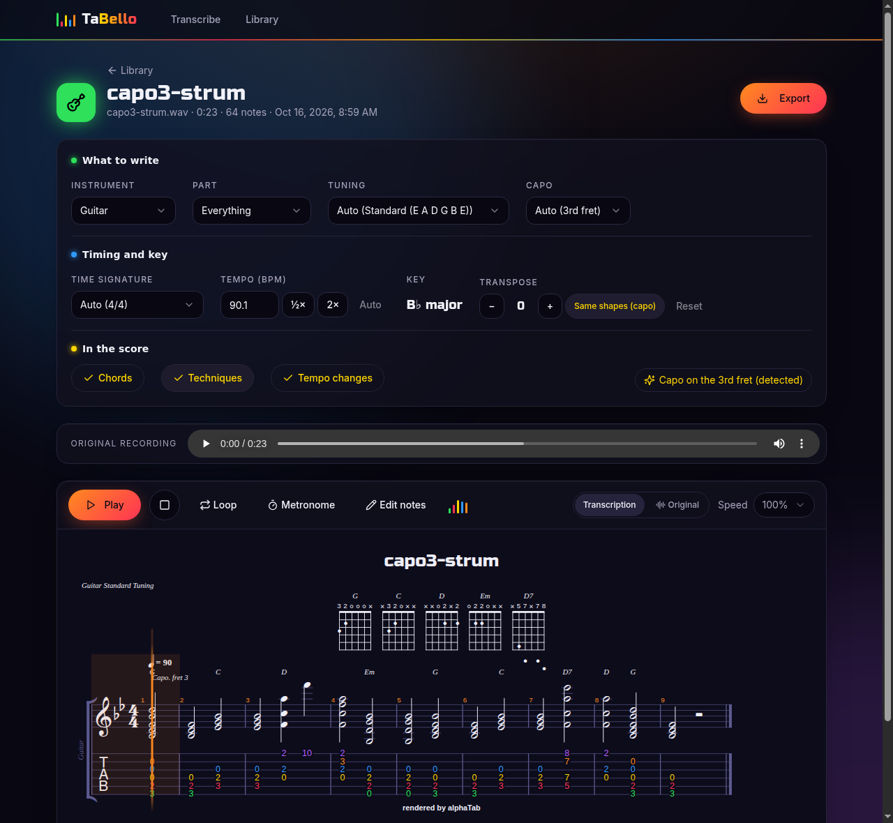
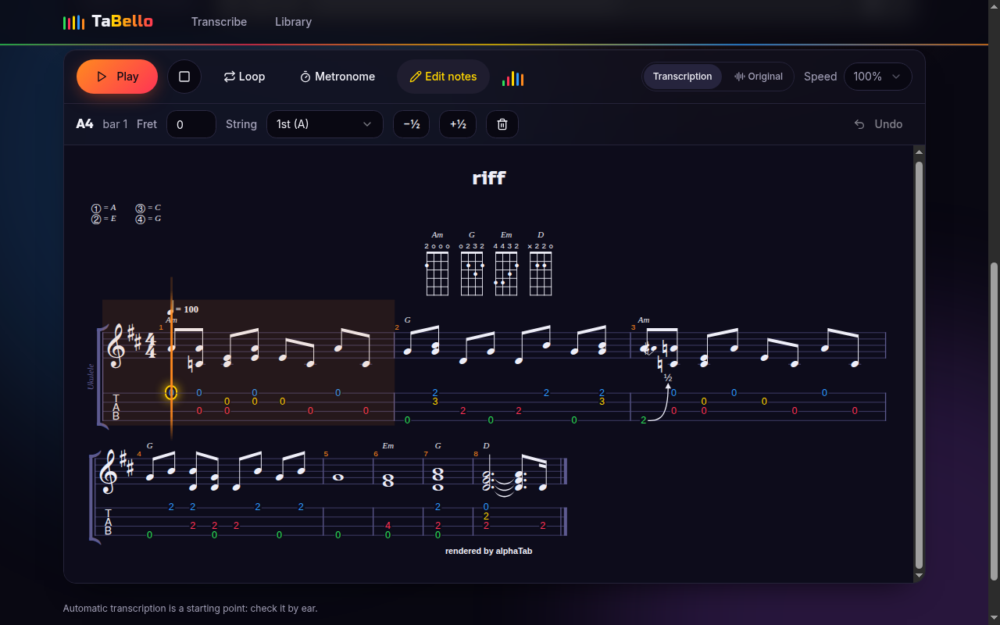

# TaBello

**Turn any recording into guitar, bass or ukulele tabs — entirely on your computer.**

TaBello is a free, open-source desktop app. Give it an audio or video file (a lesson, a live clip, a demo
you recorded) and it listens, detects the notes with a machine-learning model, and writes standard
notation plus tablature you can play back, slow down and export. No account, no upload: your recordings
never leave your machine. (TaBello goes online only to download its separation model once and to
check for new versions, which you can turn off.)

> **Public beta.** TaBello is in beta (0.1.0-beta): it works, and it still has rough edges. Please
> report what goes wrong with *Report a problem* at the bottom of the app.



## Features

### Transcription

- **Guitar, bass and ukulele**, with their common tunings: standard, drop D, half step down, D standard,
  DADGAD, open G, 5-string bass, and ukulele high G / low G / D tuning / baritone.
- **Everything is detected for you**: tempo, key, time signature (4/4, 3/4, or a triplet feel for swing
  and shuffle; 6/8 can be chosen by hand), tuning (drop D, half step down, 5-string bass, low-G
  ukulele) and **capo**. Every guess can be changed from a menu, and the score updates at once.
- **Melody or accompaniment** (*Part*): write everything, only the line on top (a lead guitar, the
  melody of a fingerstyle piece) or only the part under it. When a solo with bends takes a breath, the
  backing's notes stay out of it.
- **Metronome aware**: a click track in the recording (lessons, home recordings) is found and taken
  out before transcription; its clicks give the exact tempo and beats, and its accents the bar lines.
- **Isolate the instrument from a band recording** (optional): Demucs, a state-of-the-art source
  separation model, extracts the bass or guitar part before transcription — still on your computer.
  TaBello downloads it by itself the first time it starts (about 100 MB, once), so it is ready.
- **Clean results**: string overtones, echoes of ringing notes and the pre-echo of a pick are left out;
  strings picked again while they still ring become new notes.

### On the score

- **Notation and tablature** together, tab numbers colored by string.
- **Fingerings like a guitar teacher's**: the fretting hand sits in a position (one finger per fret) and
  moves only when it has to, or in a rest; chords use adjacent strings (a G5 is 355, not 3x0), bent and
  shaken notes are fretted, lead lines sit in the key's box (A minor at the 5th fret) and go back to it
  in a rest, and bends are pushed by the ring finger, never by the index alone. Checked note by note on
  a benchmark of 14 passages tabbed by hand (all right).
- **Chord names and diagrams** above the staff, named after the shapes you play (relative to the capo):
  the harmony is read from whole bars or half bars, so arpeggios and fingerpicking get names too (Am,
  C/G, G7, Em…), and each diagram is the shape you strum or the standard chart shape (x02210 for Am).
  Like a guitarist, TaBello reads them in context: a chord tone the hand holds but does not pick (the
  C of a C/G arpeggiated G–E–G, the third of an Am7) is filled in from the same chord heard whole
  elsewhere, so the name is C/G, not Em/G; added tones give Am7, D7/F#, Cadd9/G or Dm(add9)/A.
- **Playing techniques** (experimental): bends and releases, hammer-ons and pull-offs, slides (between
  notes, into and out of notes) and vibrato, recognized from the pitch contours and the pick attack.
- **Real notation**: in fingerstyle parts a held bass becomes a second voice (stems down) under the
  melody, a piece that starts on an upbeat begins with a pickup bar, and note durations follow how long
  the notes really ring.
- **Tempo changes**: when a recording speeds up or slows down, the bar lines follow it and the score
  carries the tempo changes (also in Guitar Pro and MIDI exports).

### Practice

- **Playback** with TaBello's synthesizer, a cursor and a metronome.
- **Play along with the original recording** (audio or video): the score follows it.
- **Loop and slow down**: select bars to loop a passage, and lower the speed without changing the pitch.
- **Transpose**, to suit a voice or a capo, a semitone at a time. With *Same shapes (capo)* the tab and
  chord shapes stay the same and the capo moves (capo on the 2nd fret: the song sounds a tone higher);
  without it the part is refingered in the new key.

### Edit, export, keep

- **Edit the tab**: click a note to change its fret, string or pitch, or delete it; undo, or restore
  the detected notes at any time.
- **Export** to Guitar Pro 7 (`.gp` — opens in Guitar Pro, MuseScore, TuxGuitar), MIDI (`.mid`) and
  alphaTex.
- **A local library** of all your transcriptions, settings and edits included.
- **Sample tracks** to try it right away: famous public-domain pieces (Greensleeves, Romance, Minuet in
  G, Ode to Joy, When the Saints Go Marching In) and a blues lick, played by TaBello's own synthesizer.
- **Private and free**: no account, no upload, no subscription. Your recordings never leave your
  computer, and it works offline once its separation model is downloaded.



| Capo and chords detected on a strummed part | Editing a ukulele tab |
| --- | --- |
|  |  |

## Download and install

No programming needed: download the installer for your computer from the
[Releases page](https://github.com/JackF007/taBello/releases) (the newest release, under *Assets*),
open it, and TaBello is ready. It has no account and costs nothing.

| Your computer | File to download | How to install |
| --- | --- | --- |
| **Windows** 10 or 11 | `TaBello-Setup-<version>.exe` | Double-click it. TaBello installs (no administrator rights needed), adds an icon to the desktop and the Start menu, and opens. |
| **Mac** with Apple Silicon (M1 or later) | `TaBello-<version>-mac-arm64.dmg` | Double-click it and drag TaBello onto *Applications*. |
| **Linux** (Ubuntu, Debian, Mint…) | `TaBello-<version>-linux-amd64.deb` | Double-click it and choose *Install*. |
| **Linux** (any other) | `TaBello-<version>-linux-x86_64.AppImage` | Right-click → *Properties* → *Allow executing as program*, then double-click it. |

TaBello is free software and its installers are not signed with paid certificates, so the first time
your computer asks for one extra confirmation:

- **Windows**: if a blue "Windows protected your PC" window appears, click *More info*, then *Run anyway*.
- **Mac**: if it says TaBello "cannot be opened", open *System Settings → Privacy & Security*, scroll
  down and click *Open Anyway* (only the first time).

To uninstall: on Windows, *Settings → Apps → TaBello → Uninstall*; on a Mac, drag TaBello from
*Applications* to the Trash; on Linux, remove it from your software center. Your transcriptions stay
in your user folder unless you delete them.

You can also run TaBello from source (see [Development](#development)).

## How to use it

1. **Pick your instrument** (guitar, bass or ukulele). For a full band recording, turn on **Isolate**
   (its separation model, about 100 MB, is downloaded once in the background the first time TaBello
   starts; without a connection, it is tried again at the next start or with *Retry*).
2. **Drop a file** or click *Choose file* — or click **Try** on one of the sample tracks. Most audio and
   video formats work (MP3, WAV, FLAC, M4A, MP4, MOV, MKV…), up to 15 minutes. Transcription takes a
   few seconds per minute of audio.
3. **Check the result** on the project page. Its settings come in three groups:
   - **What to write**: instrument, part (everything, melody / lead or accompaniment), tuning and capo,
     detected (*Auto*); pick another value if a guess is wrong;
   - **Timing and key**: time signature, tempo (if it looks off by a factor of two, use **½×** or
     **2×**), the key, and **Transpose**;
   - **In the score**: tick or untick *Chords*, *Techniques* and *Tempo changes*. A detected capo or
     metronome is shown here too.

   Then:
   - press **Play** to hear the transcription, or switch the player to **Original** to hear the
     recording while the cursor follows the score;
   - drag over bars to select them and press **Loop** to practice a passage; lower the **Speed** to
     slow it down (the recording keeps its pitch);
   - turn on **Edit notes** and click a note to fix it: type a fret, use ↑/↓ for semitones, Alt+↑/↓ to
     move it to another string, Delete to remove it, Ctrl+Z to undo. *Restore detected notes* brings
     back the original transcription.
4. **Export** to Guitar Pro or MIDI to keep editing in your favorite program (the menu says what each
   format is for).

Keyboard: Space plays and pauses.

### Getting the best results

Automatic transcription is a starting point, not a finished tab. Accuracy depends a lot on the recording:

- **Solo instrument recordings work best.** In a full band mix, vocals, drums and keys are heard too
  and produce extra or wrong notes: turn on **Isolate**. On the bundled band sample, isolating the bass
  raises the share of correct bass notes from 39% to 98%. Separation takes roughly as long as the song
  (a few minutes on a laptop) and works best for bass; guitars are taken from Demucs' "other" part,
  which also contains keyboards.
- **Clean, close recordings beat distant or noisy ones.** Heavy distortion, reverb and effects make
  notes harder to detect.
- **Choose the right instrument before transcribing**: it sets the frequency range the model listens to.
- **Sensitivity**: if you get too many stray notes, try *Strict*; if quiet notes are missing, try
  *Sensitive*.
- **Tuning matters**: drop D, half step down, 5-string bass and low-G ukulele are recognized; for other
  tunings (DADGAD, open G…) select them by hand so the frets come out right.
- **6/8**: TaBello does not guess compound meters; choose 6/8 and set the tempo in dotted quarters.
- **Techniques** are detected from how each note starts and how its pitch moves. If you see hammer-ons
  or slides that were not played (e.g. on a heavily compressed or effected recording), turn
  *Techniques* off.
- **Played to a click?** Keep the metronome in the recording, with a count-in if you can: TaBello takes
  the beats and bars from it (*Metronome · 100 BPM* appears on the project page).
- **A solo over a backing**: choose *Part → Melody / lead* to write the solo alone.

### Known limitations

- Rhythms are quantized to 16th notes, or to 8th-note triplets in the triplet feel; mixed rhythms
  (triplets inside a straight 4/4) are approximated.
- Playing techniques are inferred, not certain: palm mutes, harmonics, tapping and slides of one or two
  frets (which look like bends) are not recognized.
- Only notes can be edited (fret, string, pitch, delete); adding notes and changing rhythms is best done
  after exporting to Guitar Pro, MuseScore or TuxGuitar.
- Very fast passages (16th notes above ~150 BPM) and dense chords can lose notes; overtones can
  occasionally add an octave note. Short notes on a bass's low E string (E1) are often missed.
- A continuous stream of 16th notes can be heard as 8th notes at twice the tempo; press **½×**.
- A transposed part plays with TaBello's synthesizer only: the original recording keeps its key.
- The second voice is written for guitar parts with a held bass; bass, ukulele and strummed parts use
  one voice. Chord names cover triads, sevenths, sus, add9, madd9, 6 and power chords, with slash
  basses. Where two guitars play chords at the same time, both are heard as one and the names follow
  their sum.
- Tempo changes are followed when they are gradual or sustained; rubato and free-time passages are not.
- *Melody / lead* follows the line on top: in a fingerstyle melody (no bends or vibrato) the top notes
  of the accompaniment can stand in for it while it rests, and a solo that goes below the
  accompaniment is not followed. Two guitars playing chords together cannot be told apart.
- Where a passage can be fingered in several ways with the same notes (an open A minor or the barre at
  the 5th fret), TaBello writes the most common one; only the sound of open strings tells them apart.
- In fast strums, light top strings are often not heard, so a chord can come out incomplete.
- Isolation is limited to recordings of up to 10 minutes. Its model is not in the installers but
  downloaded by TaBello at its first start, because its weights are for personal and research use
  only (see [THIRD_PARTY_NOTICES.md](THIRD_PARTY_NOTICES.md)). If you remove it to free disk space, it
  is downloaded again only when you turn *Isolate* back on.

## How it works

1. **FFmpeg** extracts the audio track and converts it to 22.05 kHz mono. A metronome, if there is one,
   is found (a click that repeats identically on a steady beat, learned where it is heard alone) and
   subtracted, sample-aligned, at every beat. With *Isolate* on, it decodes
   44.1 kHz stereo instead, and **[Demucs](https://github.com/facebookresearch/demucs)** (Hybrid
   Transformer Demucs, run with ONNX Runtime's WebAssembly backend) separates the bass or the "other"
   part (guitars) from vocals and drums first.
2. **[Basic Pitch](https://github.com/spotify/basic-pitch-ts)**, Spotify's polyphonic note-detection model,
   runs locally with TensorFlow.js (WebAssembly backend) and lists the notes it hears.
3. TaBello cleans the result: it removes overtones (much quieter than their note, or with no attack of
   their own) and merges the phantom re-attacks the model
   reports for notes that are still ringing (using the model's own onset strength: an echo of a
   ringing string has almost none, a real re-pick a lot), recovers fast notes that the standard length
   filter would drop when they have a clear onset and a steady pitch, and lines up the notes of a chord
   that the model reports late. Strings picked again while they still ring (a bass repeated under an
   arpeggio, the strings of a strummed chord) are split into new notes where the onset detector fires
   and the note comes back up. From Basic Pitch's pitch contours and the audio's pick clicks it
   measures how each note was played: attack strength, bends, glides and vibrato.
4. It estimates the **tempo** (onset periodicity, with the beat on the bass and long notes, then a
   dynamic-programming beat tracker that follows the beats whenever a steady tempo would drift — or
   the metronome's clicks), **key** (Krumhansl–Schmuckler profiles, settled by the first and last
   chords and the final cadence) and **time
   signature** (does the off-beat fit a straight or a triplet grid? do accents and bass notes repeat
   every three or four beats?), then quantizes the notes to that grid with bar lines on the downbeats.
5. It detects the **tuning** and **capo** by comparing how playable the part is under each candidate, and
   chooses strings and frets with a Viterbi search over the fretting hand's position (the range of
   index-finger frets the notes allow, narrowing as they come), so shapes stay compact and the hand
   moves only when it has to, or in a rest (notes played legato stay on one string). Unpicked notes become
   hammer-ons, pull-offs or slides; a short glide up at the end of a note becomes a bend.
6. It splits a held bass from the melody into two voices, names the **chords** from the harmony of
   each bar (chord tones weighted by how long they ring, the bass note for slash chords), picks a
   standard diagram for each one, and **[alphaTab](https://alphatab.net/)**
   renders the notation, tablature and chord diagrams and plays them back — with its own synthesizer
   or by following the original recording.

Everything runs on your machine; transcription happens in a separate background process so the
window stays responsive.

## Development

Requirements: [Node.js](https://nodejs.org/) 22.23.4 or newer (or 24.22.1 or newer: the releases with the
October 2026 security fixes) and Git. On Windows, the
[Microsoft Visual C++ Redistributable](https://learn.microsoft.com/cpp/windows/latest-supported-vc-redist)
is also needed to unpack Electron during `npm install`.

```sh
git clone https://github.com/JackF007/taBello.git
cd taBello
npm install        # also downloads the Electron binary for your OS
npm run dev        # start the app with hot reload
```

| Command | What it does |
| --- | --- |
| `npm run dev` | Run the app in development mode |
| `npm test` | Unit and integration tests (includes a real FFmpeg + Basic Pitch run) |
| `npm run benchmark` | Accuracy benchmark on [GuitarSet](#measuring-accuracy) |
| `npm run samples` | Regenerate the sample tracks in `resources/samples/` from `scripts/samples/scores.ts` |
| `npm run test:e2e` | Build, then drive the real app with Playwright |
| `npm run lint` / `npm run typecheck` | ESLint / TypeScript checks |
| `npm run build` | Production build into `out/` |
| `npm run dist` | Build an installer for the current OS into `release/` |

Tests that need the separation model are skipped unless you point `TABELLO_DEMUCS_MODEL` at an
`htdemucs.onnx` file (e.g. the one the app downloaded into its data folder, under `models/`).

If `npm install` fails on Windows with `Cannot find native binding`, install the Visual C++
Redistributable (`winget install Microsoft.VCRedist.2015+.x64`) and run `npx install-electron`.
If transcribing says FFmpeg is missing, its download failed or an antivirus quarantined it: run
`npm rebuild ffmpeg-static` (`npm install` also fetches it again when it is missing).
Recent npm versions block the install scripts of dependencies unless they are approved: the ones
TaBello needs (FFmpeg's download, esbuild, SWC, the Windows installer builder) are listed under
`allowScripts` in `package.json`, so a plain `npm install` is enough. As a guard against hijacked
releases, `.npmrc` sets `min-release-age=7`: npm 11+ installs only versions published at least a week
ago.

### Tech stack

Electron, React, TypeScript, Vite (electron-vite), Tailwind CSS with shadcn/ui, FFmpeg, TensorFlow.js
with Spotify Basic Pitch, ONNX Runtime with Demucs, alphaTab, @tonejs/midi, Vitest, Playwright and
GitHub Actions.

### Architecture

```
┌──────────────────────────── Renderer (React) ────────────────────────────┐
│ Transcribe · Library · Project pages                                     │
│ Music engine (pure TS): tempo, key & meter detection → quantization →    │
│ tuning & capo detection → Viterbi fingering → chord names → alphaTex →   │
│ alphaTab (synth or play-along) · note editing · MIDI/GP export           │
└───────────────▲──────────────────────────────────────────────┬───────────┘
                │ window.tabello.* (typed API via contextBridge)│
┌───────────────┴──────────────── Preload ─────────────────────▼───────────┐
│ Minimal, typed IPC surface — no Node.js in the renderer                  │
└───────────────▲──────────────────────────────────────────────┬───────────┘
                │ ipcRenderer.invoke / progress events          │
┌───────────────┴───────────────── Main process ───────────────▼───────────┐
│ IPC handlers (sender + input validation) · project store (JSON files,    │
│ original notes kept when edited)                                         │
│ app:// protocol (renderer + CSP) · tabello-media:// (original file,      │
│ HTTP range requests) · save dialogs · job manager (one job, cancellable) │
│        └── utilityProcess, one per job:                                  │
│            FFmpeg → [Demucs (ONNX Runtime WASM): isolate the instrument] │
│            → 22.05 kHz mono PCM → Basic Pitch (TF.js WASM)               │
│            → overtone filtering + re-attack merging → notes              │
└──────────────────────────────────────────────────────────────────────────┘
```

```
src/
├── main/                 Electron main process
│   ├── index.ts          window, security settings, app lifecycle
│   ├── ipc.ts            IPC handlers (validated)
│   ├── protocols.ts      app:// and tabello-media:// schemes
│   ├── projects.ts       local project library
│   ├── separation/       Demucs source separation, model download/import
│   └── transcription/    utility-process worker, FFmpeg + Basic Pitch pipeline
├── preload/              contextBridge API exposed as window.tabello
├── shared/               IPC contract and instrument/tuning presets
└── renderer/             React app
    └── src/lib/music/    detection (tempo, key, meter, tuning, capo, chords), arrangement,
                          note editing, alphaTex/MIDI/GP export
benchmark/                GuitarSet accuracy benchmark
resources/samples/        sample tracks (generated by scripts/generate-samples.ts)
e2e/                      Playwright tests of the desktop app
```

### Design decisions

- **No `fluent-ffmpeg`**: it is deprecated upstream; TaBello spawns the bundled FFmpeg binary directly.
- **WebAssembly instead of `tfjs-node`**: same results, under 1 MB instead of ~390 MB of unmaintained
  native code, and no platform-specific builds. `tfjs-node` was ~3× faster in a benchmark and could
  come back as an optional accelerator.
- **Bundled worker**: only `tfjs-core`, `tfjs-converter` and the WASM backend are shipped (the app
  archive went from 299 MB to 22 MB).
- **alphaTab** renders notation and tablature and plays them back. It cannot import MIDI, so detected
  notes are converted to alphaTex.
- **Measured post-processing**: on a synthetic plucked-string test (riff + strummed chords, 53 notes),
  raw Basic Pitch output has precision 0.48 / recall 0.89; TaBello's thresholds, overtone filtering and
  re-attack merging bring it to 0.83 / 0.85. A regression test guards these numbers.
- **Notation quality is tested against the real scores**: the sample tracks are rendered from known
  scores, transcribed, and the written notes compared with the originals in beats — pitch, position,
  duration, voices, bar lines and chord names (`scripts/samples/notation.test.ts`). On those pieces the
  notes are 95–100% right and durations 97–100%, Greensleeves went from 81% to 100% precision after
  echo removal and fast 16th-note runs at 140 BPM from 17% to 85% recall (`fast.test.ts`). These are
  synthetic recordings: please run the GuitarSet benchmark on real ones and share the numbers.
- **Harder pieces** (`scripts/samples/complex.test.ts`) are rendered clean and "performed" (timing off by
  up to ±15 ms, dynamics ±20%, room reverb and noise): Bach's Prelude BWV 1007 in 16ths, the Entertainer's
  ragtime syncopation, a chord-melody Amazing Grace in 3/4, a funk bass line and a strummed rhythm part.
  They check notes, durations, bar lines, tuning, capo and chord names. Fixes they led to: standard
  tuning is kept unless a note requires another (the Entertainer had come out in D standard with a
  capo), low notes heard just before they are plucked are dropped, a strum hitting a ringing string
  again counts as a new note (recall 80% → 95%), a capo never cuts off a clear bass note, and chord
  names follow the bass on the beat (an alternating bass is not an inversion).

- **Fingering is tested like a teacher would check it** (`src/renderer/src/lib/music/fingering.test.ts`):
  14 passages written as tab (arpeggios, open and barre chords, power chords, pentatonic licks with
  bends, a lead moving from the 15th fret to the first box, an open-position melody, a riff, Travis
  picking) go in as notes, and every note's string and fret is compared; where teachers would write a passage in more than one way, each is accepted.
  Before the hand-position model, power chords came out 17% right and a pentatonic lick 13%.
- **Melody and accompaniment** are measured on the sample recordings whose melody is known
  (`scripts/samples/parts.test.ts`): melody notes found 92–100% (precision) and 86–100% (recall).
- **Metronome**: a synthetic click track with an accent, under a guitar, must be found on 90% of its
  beats and its count-in removed (`src/main/transcription/metronome.test.ts`); on a real lesson video
  the clicks heard alone drop by 21 dB and the tempo comes out at exactly 100 BPM.

### Measuring accuracy

[GuitarSet](https://guitarset.weebly.com/) (360 annotated guitar recordings, CC BY 4.0) can be used to
measure TaBello's accuracy. Download and unzip `annotation` and `audio_mono-mic` into one folder, then:

```sh
GUITARSET_DIR=/path/to/GuitarSet npm run benchmark
# optional: GUITARSET_LIMIT=20, GUITARSET_FILTER=solo, GUITARSET_SENSITIVITY=high,
#           GUITARSET_AUDIO=audio_hex-pickup_debleeded (cleaner pickup audio)
```

It reports note precision, recall and F1 (correct pitch, onset within 50 ms) and the share of correctly
detected notes placed on the string the guitarist actually used — both for the whole pipeline and for
the fingering optimizer alone (arranging the annotated notes). Results are also written to
`benchmark/results/`. Please share your numbers in an issue when you change the pipeline.

### Releases

Releases are built for free by GitHub Actions: push a tag matching the version in `package.json`
(e.g. `git tag v0.1.0 && git push origin v0.1.0`) and installers for Windows, macOS and Linux are
attached to a draft GitHub Release. Builds are unsigned (macOS ad-hoc signed); free code signing for
open-source projects such as [SignPath Foundation](https://signpath.org/) can remove the Windows warning.

## Roadmap

Ideas, roughly by priority — contributions welcome:

- [x] Accuracy benchmark tool for [GuitarSet](https://guitarset.weebly.com/) (publish baseline numbers)
- [x] Play along with the original recording: synced cursor, A–B loop, slow-down without pitch change
- [x] Detect drop D, half step down, 5-string bass and low-G ukulele
- [x] Chord names and chord diagrams
- [x] Triplets, swing, 3/4 and 6/8
- [x] Edit notes directly in the tab
- [ ] Tune thresholds and fingering costs on GuitarSet
- [x] Optional source separation to isolate the guitar or bass from a full mix (Demucs via ONNX
  Runtime, model downloaded on demand)
- [ ] A dedicated guitar stem (Demucs 6-source model) and GPU acceleration (WebGPU/DirectML)
- [ ] Detect recordings tuned off A = 440 Hz (e.g. 432 Hz) from pitch bends
- [x] Write techniques: bends, slides, hammer-ons, pull-offs, vibrato (experimental)
- [x] Tempo changes within a piece
- [ ] Add notes and change rhythms in the editor
- [x] Transpose, with a capo keeping the same shapes
- [ ] Transpose the original recording too (pitch shifting), to play along in the new key
- [ ] Code signing for free through an open-source program (e.g. SignPath Foundation), so Windows
  stops asking for confirmation
- [ ] Intel Mac builds
- [x] Fingering benchmark and a hand-position model
- [x] Melody / accompaniment parts
- [x] Metronome detection and removal
- [ ] Use stereo position to tell two guitars apart in studio mixes
- [ ] Complete strummed chord shapes the model only half hears (optional)
- [x] A home page and project page that show every feature

## Reporting a problem

At the bottom of the app, *Report a problem* opens GitHub's forms for a bug or a wrong transcription.
*Show the log* opens the folder of `tabello.log`, the list of errors TaBello met: attach it to the
report. It holds error messages only, never your recordings (read it first if you like: an error
can mention a file name).

*Check for updates* (on by default) makes TaBello ask GitHub, at startup, whether a newer version is
out; nothing is sent about you or your files, and nothing is installed by itself: a bar offers the
download page.

## Contributing

Bug reports, transcription examples and pull requests are welcome; see [CONTRIBUTING.md](CONTRIBUTING.md).
For a transcription that came out wrong, a short clip (a few seconds) plus the settings you used helps most.

## License

TaBello is free software: you can redistribute it and/or modify it under the terms of the
[GNU General Public License v3.0 or later](LICENSE).

It builds on many open-source projects — FFmpeg (GPL-3.0), Spotify Basic Pitch and TensorFlow.js
(Apache-2.0), alphaTab (MPL-2.0), Electron and React (MIT), and fonts under the SIL Open Font License.
See [THIRD_PARTY_NOTICES.md](THIRD_PARTY_NOTICES.md) for the full list and their licenses.
